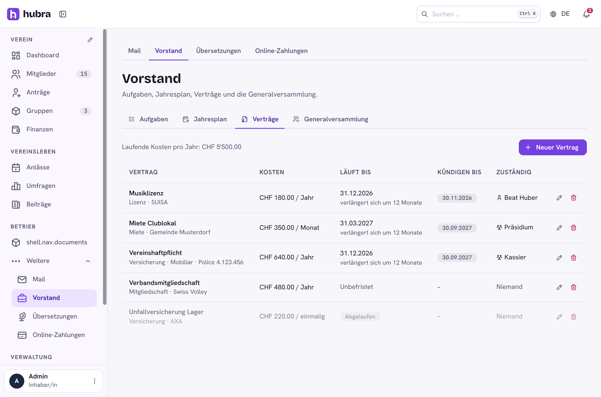

# Board

  

A plugin for [Hubra](https://hubra.club). What the board (Vorstand) runs: tasks per function that pass to the next holder, a year planner of recurring duties, a register of contracts and insurances with notice reminders, and the general meeting (Generalversammlung) from invitation and agenda to sign-in, quorum and minutes.

**Version** 1.0.0 · **Works with** Hubra >=0.2,<1 · **Plugin id** `board` · **Needs** the members and functions modules

## What it does

| Tab | |
| --- | --- |
| Aufgaben | Tasks for a person or a function's holders, with due dates. A bell reminder goes once when a task is due within three days. |
| Jahresplan | Recurring duties on a fixed day each year. Within the duty's lead time it becomes a task and the person in charge hears about it. |
| Verträge | Contracts with cost, term, notice and renewal. Shows the next notice deadline, reminds before it, and adds up the running cost per year. |
| Generalversammlung | Agenda (standard items to start), invitation deadline from the statutes with a reminder to whoever created the meeting, invitation to all active members with a PDF, sign-in and quorum, minutes and decisions per item, linked polls, minutes PDF. |

Reminders run once a day per club (`board-reminders-daily`) and go to the bell
under the member's "Aufgaben" notification setting. The GV invitation always
comes.

Permissions: `board.tasks.read`, `board.tasks.update`, `board.contracts.read`,
`board.contracts.update`, `board.meetings.update`. Members can always tick off
their own tasks and see meetings they are invited to.

## Install

Platform admins install it from the plugin catalogue in the manager portal
(official Marketplace, <https://plugins.hubra.club/index.json>, signed with
the Hubra project key). Clubs then switch it on under Einstellungen → Module
& Plugins.

## Develop

Clone this repository into `plugins/board` of a Hubra checkout. Its tests
then run with Hubra's (`cd app/backend && pytest ../../plugins/board`), and
`npm run build:plugin` in `app/frontend` builds its frontend. The workflow
does the same against Hubra's `main` on every push and pull request.

## Releasing

Bump `version` in `plugin.yaml`, add a `## <version>` section to
`CHANGELOG.md`, commit, then publish a GitHub release tagged `v<version>`
(web UI, or `gh release create v<version> --target main --notes ""`). The
workflow tests the plugin and builds its frontend; a separate job in the
`plugin-signing` environment, the only one with the `HUBRA_SIGNING_KEY`
secret, signs it; then `board-<version>.zip` is attached to the release. Files listed in `.releaseignore` stay out of the zip.

Source: <https://github.com/hubra-app/hubra-plugin-board>
